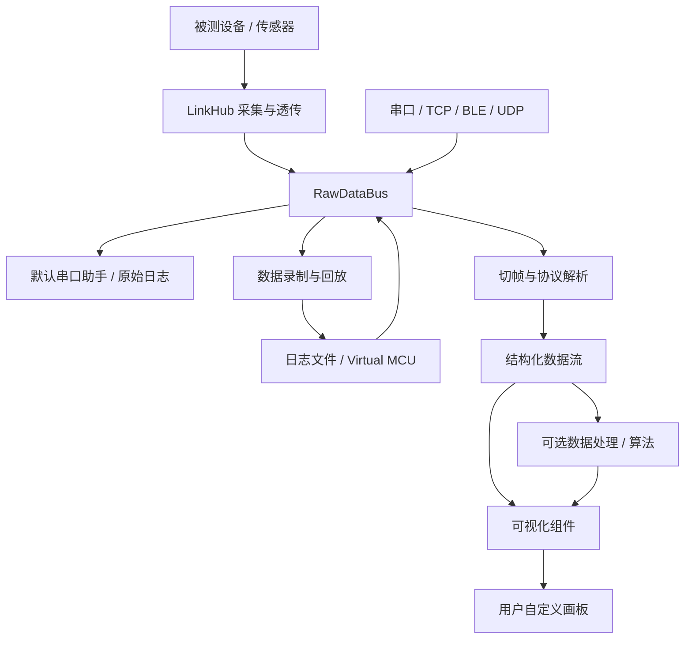

# LinkStudio & LinkHub — 产品构想与长期设计方向

> 文档版本：V0.3 · 2026-11-24  
> 文档性质：产品愿景与设计原则，非当前版本的详细开发规格。

## 1. 项目背景

在实际嵌入式开发过程中，经常需要同时使用多个上位机工具。例如，串口通信需要串口助手，GNSS 定位需要 NMEA 解析工具，蓝牙通信需要 BLE 调试工具，IMU 计步算法需要波形分析工具，私有协议可能还需要单独编写上位机。

这种工作方式存在几个问题：

- 不同工具的操作方式不同，需要反复学习。
- 数据获取、协议解析和可视化通常被绑定在特定软件中，难以复用。
- 私有协议和特殊业务场景难以得到现成工具的支持。
- 实时调试与历史日志分析往往需要不同的工具。
- 企业使用第三方软件时，需要考虑授权范围、开源许可证及数据安全问题。

因此，希望构建一套面向嵌入式工程师的通用调试平台，将数据获取、协议解析、数据处理与可视化统一起来，使工程师能够根据自己的项目需求构建调试环境，而不是反复寻找新的上位机。

## 2. 产品定位

### 2.1 LinkStudio：软件平台

面向嵌入式工程师的可配置、可扩展的数据调试与可视化工作台。

串口助手是最常用的功能，因此作为软件默认工作空间保留，但不再是软件功能的边界。用户可以创建自己的画板，选择数据来源、定义协议解析方式、组合可视化组件并保存整个调试环境。

### 2.2 LinkHub：硬件平台（暂定名）

面向嵌入式开发的数据采集、通信与硬件扩展设备，初步考虑采用 ESP32-S3 作为主控。

LinkHub 负责将不同接口、不同设备、不同传感器的数据传输给 LinkStudio，也可以接收上位机的控制命令。第一版可以从 BLE 透传和 USB 通信开始，不必一次集成所有传感器。

两者的职责划分：**LinkHub 解决数据如何获取，LinkStudio 解决数据如何使用。**

LinkStudio 不强制依赖 LinkHub；PC 能够直接访问的串口、网络、BLE 和日志文件均可直接作为数据来源。LinkHub 也应尽量采用开放、明确的通信接口，避免只能配合 LinkStudio 使用。

## 3. 整体系统架构



各类数据来源直接接入 RawDataBus，不再设置独立的通信通道抽象层。数据来源是逻辑概念，用于描述数据从哪里获取，而不是额外的软件层级。

核心思想是各部分职责独立：

| 功能部分 | 职责 | 示例 |
| --- | --- | --- |
| 数据来源 | 获取和发送原始数据 | Serial、TCP、BLE、Log File、Virtual MCU |
| 原始数据分发 | 将数据提供给不同订阅者 | RawDataBus |
| 协议解析 | 切帧、校验、字段提取、必要的跨帧聚合 | NMEA、JSON、KLV、私有协议 |
| 数据处理 | 可选的滤波、换算、算法、统计 | FFT、计步算法、单位转换 |
| 可视化 | 展示已绑定的数据 | 波形图、卫星天空图、仪表盘 |
| 工作空间 | 管理画板、组件、绑定关系与配置 | GNSS Lab、IMU Lab |

组件不应直接依赖特定串口或协议。只要不同解析器能够输出兼容的数据结构，同一个组件就应能够复用。

## 4. LinkStudio 用户交互构想

### 4.1 主界面

左侧导航栏默认保留串口助手，并提供一个 `+` 按钮，用于新建空白画板。

```text
┌─────────────────────────────────────────────────────────┐
│ LinkStudio                                              │
├───────────────┬─────────────────────────────────────────┤
│ 串口助手      │ 当前工作空间          + 添加组件        │
│ GNSS Lab      ├────────────────────┬────────────────────┤
│ IMU Lab       │ 实时波形           │ 数据卡片           │
│ 自定义画板    ├────────────────────┼────────────────────┤
│ + 新建画板    │ 数据表格           │ 原始日志           │
│               │                    │                    │
└───────────────┴────────────────────┴────────────────────┘
```

画板不预先规定业务用途。用户可以添加、删除、移动、调整组件大小，并对组件进行独立配置。

### 4.2 创建调试环境的流程

1. 创建空白画板并命名。
2. 添加需要的可视化组件。
3. 选择已有数据源，或创建新的数据源。
4. 选择内置解析器，或者定义自有协议解析规则。
5. 将解析后的字段绑定到组件的输入端。
6. 根据需要增加过滤、单位转换或算法处理。
7. 保存画板，后续直接复用。

一个画板应允许多个数据源共存；多个组件也可以共享同一条解析后的数据流，避免为每个组件重复打开串口或解析相同的数据。

### 4.3 组件库构想

| 组件 | 用途 |
| --- | --- |
| 原始日志 / HEX 窗口 | 查看原始收发数据 |
| 实时波形图 | IMU、PPG、电流等连续数据 |
| 数据卡片 / 仪表盘 | 温度、电压、心率、步数等 |
| 数据表格 | 结构化报文、设备状态、扫描结果 |
| 柱状图 | 卫星信号强度、统计数据 |
| 卫星天空图 | GNSS 卫星方位角、仰角 |
| 地图 / 轨迹 | 经纬度与运动轨迹 |
| 3D 姿态 | IMU 姿态角或四元数可视化 |
| 输入框 / 按钮 / 开关 | 下发配置、发送命令、控制设备 |

组件应尽量通用，同时允许专业组件具有明确的输入结构。例如卫星天空图需要卫星编号、方位角、仰角等字段，而不是任意一个数值。

## 5. 协议解析与数据绑定

### 5.1 解析器类型

- 内置解析器：NMEA、JSON、常见二进制协议等。
- 配置式解析器：帧头、长度、偏移、字段类型、大小端、校验、比例系数等。
- 高级解析器：后期通过受控脚本或插件实现复杂业务协议。

必须区分通信接收和完整协议帧：串口或 TCP 的一次接收不一定对应一个完整报文，解析器需要处理粘包、拆包、错误数据和重新同步。每个独立数据流应拥有相应的解析状态。

### 5.2 数据绑定示例

假设某设备输出以下 JSON 数据：

```json
{
  "timestamp": 10230,
  "acc_x": 0.012,
  "acc_y": 0.034,
  "acc_z": 0.981,
  "steps": 128
}
```

配置一个波形图，绑定 `acc_x`、`acc_y`、`acc_z`；再配置一个数值卡片绑定 `steps`，即可形成基础计步调试画板。

当数据源从 Serial 切换到 TCP 或历史日志时，只要解析结果的字段及语义一致，组件配置就不需要修改。

内部结构化数据应保留必要的来源标识、时间戳、字段类型、单位及有效性信息。具体数据模型和总线设计待进入协议解析阶段后确定。

## 6. 典型使用场景

### 6.1 GNSS / NMEA 调试

被测设备通过 BLE 输出 NMEA，LinkHub 通过 BLE 接收并经 USB 转发至 LinkStudio。上位机完成 NMEA 切帧、校验与解析，再将结果提供给不同组件。

| NMEA 语句 | 对应展示内容 |
| --- | --- |
| GGA | 经纬度、定位质量、海拔 |
| GSV | 卫星编号、方位角、仰角、信号强度 |
| GSA | 参与定位的卫星、DOP |
| GST | 定位误差统计 |
| RMC | 时间、速度、航向、定位有效性 |
| VTG | 地面速度、航向 |

画板可同时显示原始 NMEA 日志、卫星天空图、卫星信号强度、地图轨迹和定位状态。解析器需处理 GSV 多语句聚合、多星座区分等问题。

配置完成后，将其保存为 GNSS 工作空间。下一次调试只需要连接新的设备并选择数据源，无需重新寻找或学习专用 NMEA 上位机。

### 6.2 IMU 与计步算法验证

采集三轴加速度、三轴陀螺仪、采样时间戳以及可选的硬件计步结果。

上位机能够显示实时波形、姿态、滤波前后数据及算法输出，并记录走路、跑步、上下楼梯、静止等实际场景。

后期可引入算法实验室：使用同一份采样记录反复运行不同算法版本，与人工标注的真实步数进行比较。也可考虑将 C 算法编译为 DLL，通过 C# P/Invoke 调用，使 MCU 和 PC 复用同一份算法源码。

### 6.3 心率与其他传感器

LinkHub 可扩展 PPG 传感器，上传光学原始采样数据。上位机可显示滤波前后的波形、峰值、心跳间隔及信号质量，用于算法实验，而非未经验证的医疗判断。

同样的工作方式可以推广到温湿度、电压、电流及其他传感器。

## 7. LinkHub 硬件演进方向

| 阶段 | 建议功能 |
| --- | --- |
| 初期 | ESP32-S3、USB 通信、BLE 扫描与连接、BLE 数据透传 |
| 后续 | UART、Wi-Fi/TCP、外部 SPI/I²C 接口、GNSS、IMU |
| 扩展 | SD 卡离线记录、PPG、LoRa、屏幕、按键、电池 |
| 独立专项 | DAPLink、电流检测、基础逻辑分析等 |

硬件可以采用桌面底座与功能扩展模块的设计，也可以发展出便携式传感器采集终端（例如手表形态）。这些属于后续方向，不是第一版的必要条件。

BLE 透传需要明确被测设备的 GATT 服务、特征值、通知/写入方式及安全要求。BLE 不存在一个适用于所有设备的统一串口透传服务，因此需要允许用户配置相关参数。

当 LinkHub 同时承载多个设备或接口时，需要在转发协议中区分来源，并考虑数据流控制、序号、时间戳及丢包检测。可以评估复用已有的 Sync + Length + CRC + SeqId + Flag + CMD + KLV 通用帧协议，但暂不将其确定为唯一方案。

## 8. 工作空间保存与复用

工作空间文件（扩展名暂定 `.linkworkspace`）应保存：画板布局、组件类型及配置、逻辑数据源、解析规则、字段绑定、数据处理规则以及配置版本。

```text
Workspaces/
├── GNSS.linkworkspace
├── IMU.linkworkspace
├── HeartRate.linkworkspace
├── AT_Debug.linkworkspace
└── Product_Test.linkworkspace
```

工作空间应与具体 COM 口、IP 地址等机器相关配置适当解耦，使导入者可以重新绑定实际设备。密码、密钥等敏感信息不应默认随模板导出。

未来可以形成共享模板库，让同事复用同一套调试环境，而不必重复配置或重新开发专用上位机。

## 9. 当前开发状态与演进路线

截至本文档编写时，LinkStudio 仍处于数据接收与转发阶段。已有开发方向包括 RawDataBus、RawDataPacket、Virtual MCU、订阅与发布机制，以及 Worker 命令队列。当前设计已取消独立的通信通道抽象层，各数据来源直接接入 RawDataBus。

**本次产品构想不意味着立即重构当前代码。** 应继续完善通信基础设施，在真实场景驱动下逐层扩展。

### 9.1 版本里程碑（Roadmap）

以下版本号为产品规划版本，不代表已经发布的版本，也与本文档版本独立。当前处于 LinkStudio V0.1 开发阶段。每个版本应形成可验证的成果，不要求一次完成全部长期愿景。

| 版本 | 里程碑 | 主要交付内容 | 验收条件 |
| --- | --- | --- | --- |
| V0.1（当前） | 通信基础设施 | RawDataBus、RawDataPacket、Virtual MCU、收发与转发、单元测试 | 多订阅者能接收数据；生命周期、顺序、异常隔离与缓冲区上限通过测试 |
| V0.2 | 通用串口助手 | 串口连接、收发显示、HEX/文本、发送预设、日志保存 | 能独立替代日常使用的基础串口助手 |
| V0.3 | 协议解析 | 切帧、NMEA、JSON、结构化数据 | 同一份报文在不同接收分片下得到一致解析结果；错误报文可恢复 |
| V0.4 | 可视化组件 | 波形图、数据卡片、表格、卫星信号柱状图与天空图 | NMEA 实时数据可驱动卫星视图；模拟 IMU 数据可驱动波形图 |
| V0.5 | 自定义画板 | 左侧加号、空白画板、组件增删与布局、数据源及字段绑定、配置保存 | 用户无需修改代码即可组合已有组件；重启后恢复工作空间 |
| V0.6 | 数据实验室 | 日志录制、文件数据源、回放时间轴、基础数据处理与算法验证 | 同一画板可切换实时串口和历史日志；同一记录可重复用于算法测试 |
| V0.7 | LinkHub 最小原型 | ESP32-S3、USB、BLE 扫描连接及双向透传 | 被测 BLE 设备的 NMEA 数据经 LinkHub 进入现有 GNSS 画板，无需修改解析器或组件 |
| V0.8 | 自定义协议引擎 | 配置式二进制解析、帧头、长度、CRC、字段类型、字节序及条件字段 | 至少一种私有协议可通过配置完成解析与组件绑定 |
| V0.9 | 平台扩展 | 插件机制、数据流编排、工作空间导入导出与模板共享 | 新增一种解析器或组件无需修改核心通信逻辑；模板可跨设备复用 |
| V1.0 | 稳定工具平台 | 稳定性、性能、软硬件协同、用户文档、授权管理 | 核心场景完成端到端回归测试，可持续用于日常嵌入式调试 |

### 9.2 关键里程碑与范围控制

- **V0.2：第一个可日常使用的版本。** 优先满足串口调试，不以自定义画板或 LinkHub 为前置条件。
- **V0.4：验证核心技术路线。** 通过 Virtual MCU 或真实串口 → RawDataBus → NMEA 解析 → 卫星信号强度图，验证通信、解析与显示的解耦。
- **V0.5：验证产品核心价值。** 用户可自行搭建调试画板，而不是只能使用预设页面。
- **V0.7：完成软硬件闭环。** LinkHub 第一版以 BLE 透传为主，不要求屏幕、IMU、PPG 或自研 PCB。
- **V1.0：稳定交付。** 不以实现所有设想为条件，高级算法、硬件扩展和插件能力可按实际需求持续迭代。

### 9.3 里程碑执行原则

1. 一次聚焦一个版本的核心目标；新想法先记录到愿景文档或待办列表。
2. 每个版本具备明确的验收条件，通过测试或实际使用验证后再进入下一阶段。
3. 不提前实现没有真实需求支撑的抽象层、通用引擎或插件系统。
4. 暂不设定固定发布日期，阶段顺序及范围可根据实际开发情况调整。
5. LinkStudio 与 LinkHub 可以独立发布和维护，表中的 V0.7 仅表示软硬件集成里程碑，不代表 LinkHub 固件版本号。

当前 V0.1 阶段重点关注数据顺序、来源追踪、缓冲区上限、背压策略、订阅者异常隔离及自动化测试。继续完成数据接收与转发，不因长期愿景而扩大本阶段范围。

**愿景上，把它当成一个平台；开发上，把它当成一个个小工具。**

## 10. 学习成本、授权与长期维护

自研统一工具的价值在于统一使用方式、支持私有协议、控制数据流向，并逐步降低重复学习和重复开发的成本。但自研也意味着需要承担持续开发、测试和维护成本。

自研并不等于不存在知识产权风险。使用第三方 UI 库、图表库、地图服务、协议规范、算法及示例代码时，仍应确认各自的授权范围。建议建立 `THIRD_PARTY_NOTICES.md` 记录第三方依赖、版本、许可证及必要声明，并优先选择授权清晰的组件。不要直接复制未获授权的专有软件代码或资源；涉及公司项目和数据时，应遵守内部规定。

## 11. 长期设计原则

1. 数据来源可替换：通信接口不应决定业务功能。
2. 协议解析可配置：私有协议不应必然需要重新开发上位机。
3. 数据处理可扩展：允许在解析与显示之间增加算法。
4. 可视化组件可组合：用户自主决定画板的用途。
5. 工作空间可保存、复用与分享。
6. 实时数据与历史数据尽量使用相同的处理流程。
7. LinkStudio 与 LinkHub 相互增强，但不强制绑定。
8. 优先满足真实开发需求，避免过早设计复杂的平台能力。

## 12. 项目愿景

LinkStudio 的最终目标不是简单地把所有现有调试软件的功能都集成进来，而是提供一套能够构建、复用和扩展调试工具的基础能力。

遇到新的嵌入式开发场景时，不再首先考虑寻找哪个专用上位机，而是考虑需要什么数据源、什么解析器和什么可视化组件。

**从寻找工具，到构建工具，再到复用工具。**

LinkStudio + LinkHub 希望最终成为嵌入式工程师日常工作中的统一软硬件调试平台。
